# MedAssist AI

MedAssist AI is a telehealth platform that connects patients with doctors and cuts down the paperwork in between. Patients book a visit, describe their symptoms in a short intake form, and follow the appointment from their dashboard. Before the consultation, Google Gemini reads the intake, rates the risk level and drafts a SOAP note, so the doctor already knows why the patient is there. The doctor reviews and edits that draft, adds prescriptions or a follow-up, and sends the patient a summary written in plain language. Patients and doctors can message each other in real time while an appointment is active, and the chat closes a week after the visit is completed. Administrators get their own console to onboard doctors, manage accounts, watch appointment volume and review an audit log of sensitive actions.

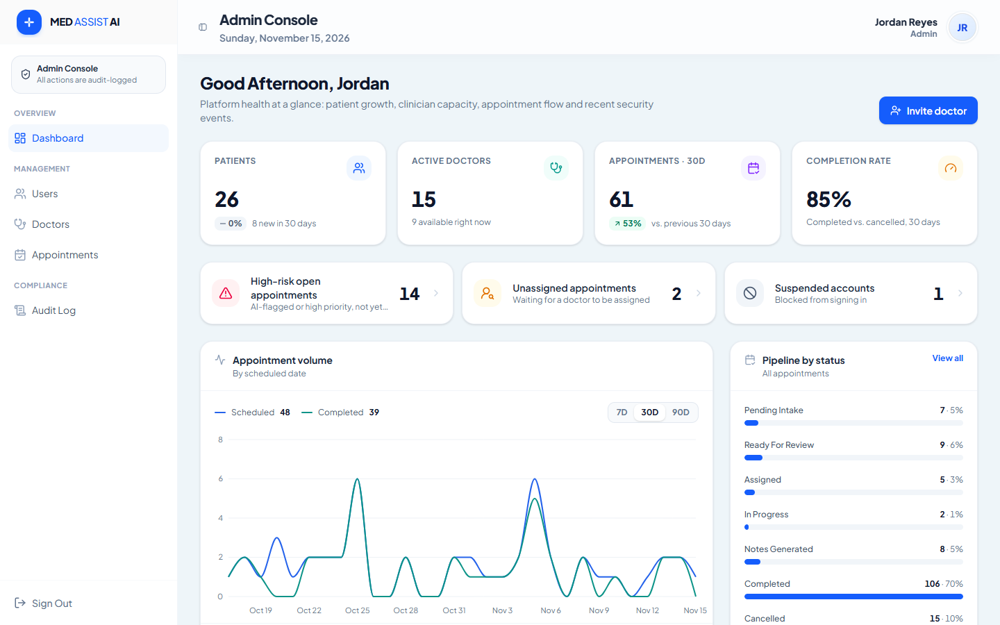

---

## Contents

- [Features](#features)
- [Screenshots](#screenshots)
- [Tech stack](#tech-stack)
- [Architecture](#architecture)
- [Getting started](#getting-started)
- [Environment variables](#environment-variables)
- [Database & migrations](#database--migrations)
- [Security & privacy](#security--privacy)
- [Project structure](#project-structure)
- [Deployment](#deployment)
- [Known limitations & roadmap](#known-limitations--roadmap)

---

## Features

### Patients
- **Self-service booking** in five steps (visit type → doctor → date & time → details → confirm), with protection against duplicate active bookings with the same doctor.
- **Pre-visit intake form** (chief complaint, symptoms, pain score, allergies, medications) that feeds AI triage.
- **Appointment journey tracker** from intake through to a completed visit.
- **Visit summaries** written for patients, plus diagnosis, treatment plan and prescriptions.
- **Notifications** and **real-time messaging** with the assigned doctor.

### Doctors
- **Clinical dashboard** with the next appointment, a calendar, an appointment volume chart and recent patients.
- **AI workflow insights** on every appointment: suggested risk level, priority, a triage summary and recommendations.
- **AI SOAP drafts** (Subjective, Objective, Assessment, Plan) that can be applied, edited and saved as the clinical note.
- **Prescriptions, follow-up planning** and an AI-generated plain-language summary for the patient.
- **Full patient record** with the care timeline and prescription history, available only to doctors assigned to that patient.

### Administrators
- **Platform dashboard**: patient growth, active doctors, 30-day appointment volume with period-over-period change, completion rate, tiles for high-risk, unassigned and suspended items that need attention, the status pipeline, doctor workload and recent activity.
- **User management**: search by name, email or MRN; filter by role and status; change roles; suspend and reactivate accounts with a recorded reason; sign a user out of every device.
- **Doctor onboarding**: invite a clinician by email. They set their own password through a single-use link, so admins never handle credentials. Admins can also set availability and resend invites.
- **Appointment oversight**: filter by status, priority, risk and assignment; assign or reassign doctors; cancel visits with notifications to every party.
- **Audit log**: a filterable, paginated history of sign-ins, account changes, admin actions and patient-record access.

### Authentication
- Email and password sign-up with **email verification** (auto sign-in after verifying, resend with a cooldown).
- **Forgot / reset password** with single-use, one-hour tokens. A reset signs the user out on every device.
- **Google sign-in**, shown only when OAuth credentials are configured.
- **Role-based routing** for `PATIENT`, `DOCTOR` and `ADMIN`, with safe `next=` redirects (no open redirects).
- **Rate limiting** on sign-in, sign-up, password reset and verification endpoints.

---

## Screenshots

### Patient

| Dashboard | Booking flow |
|---|---|
| 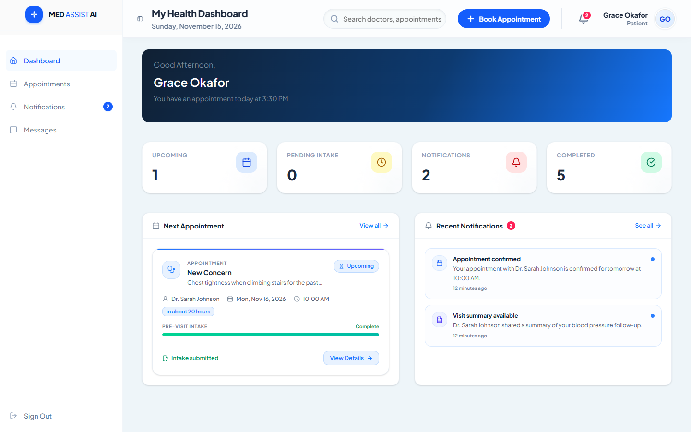 | 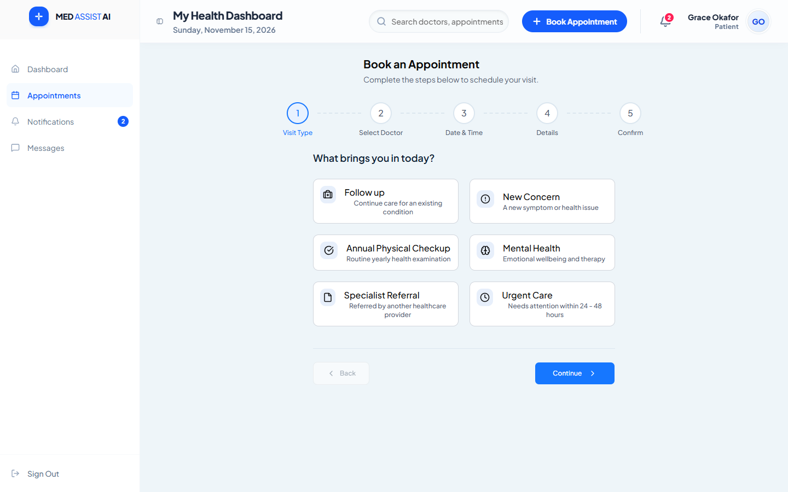 |

| Visit summary, diagnosis & prescriptions |
|---|
| 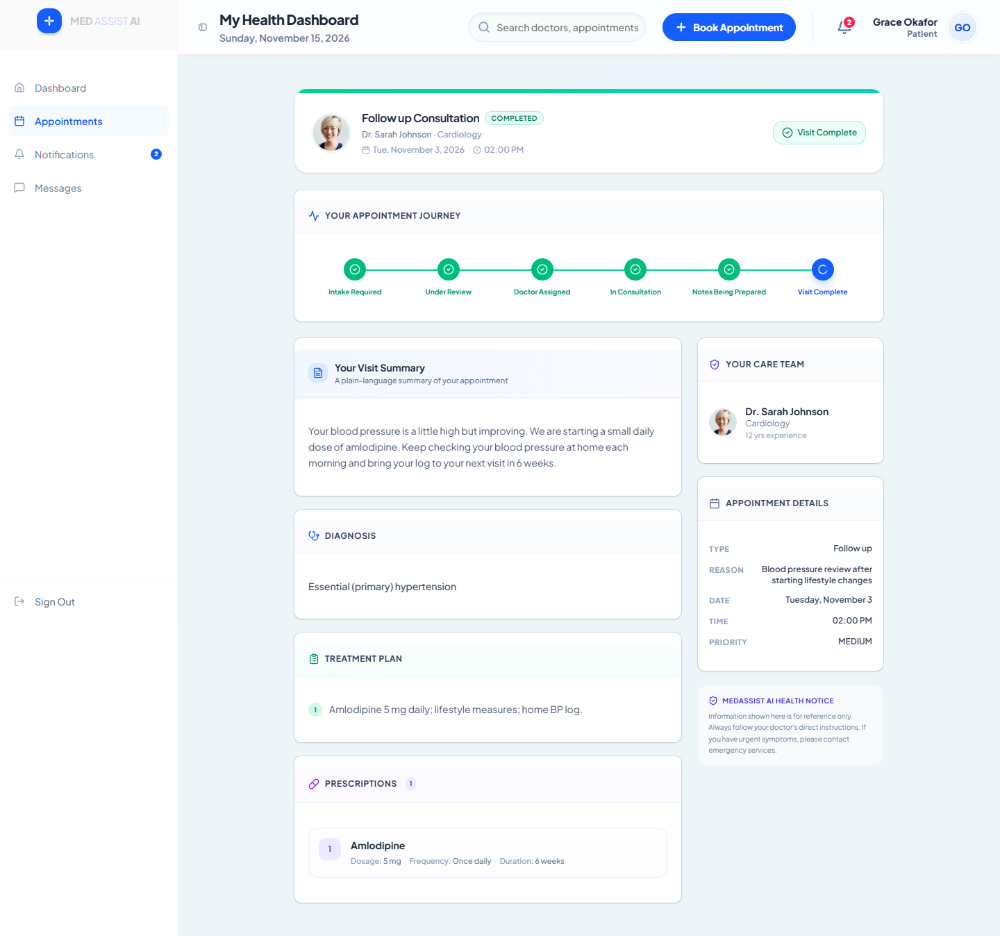 |

### Doctor

| Clinical dashboard | Patient record |
|---|---|
| 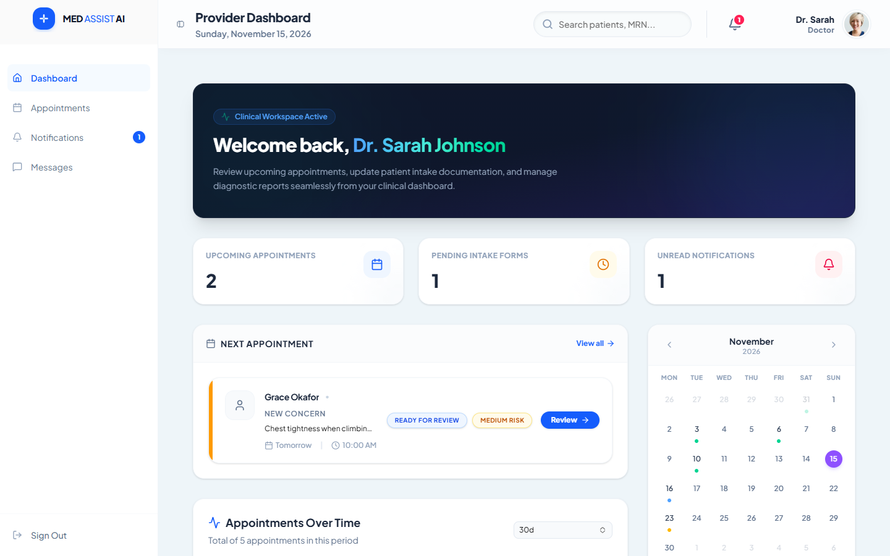 | 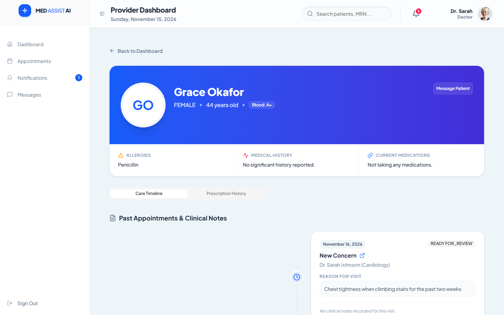 |

| Intake review | AI triage & SOAP draft |
|---|---|
| 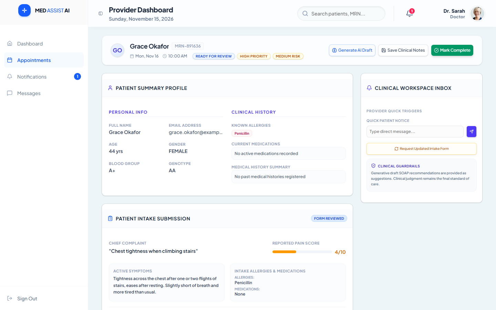 | 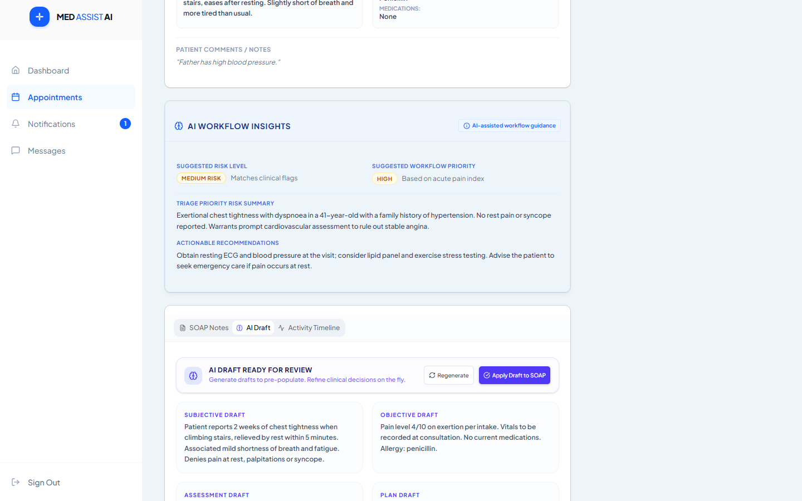 |

| Real-time messaging |
|---|
| 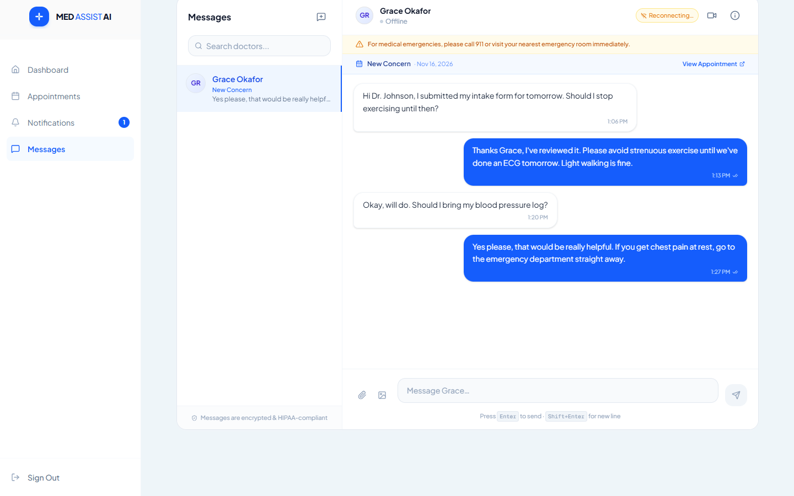 |

### Administrator

| User management | Doctor onboarding & availability |
|---|---|
| 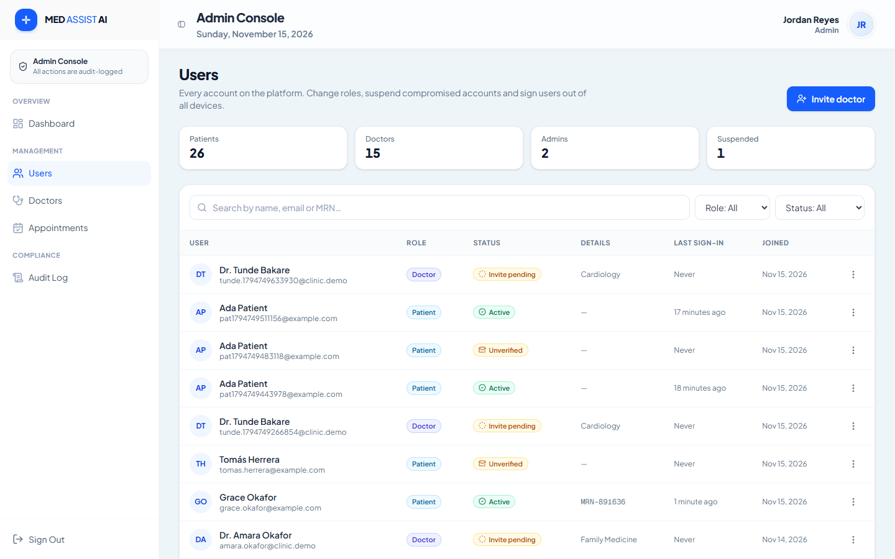 | 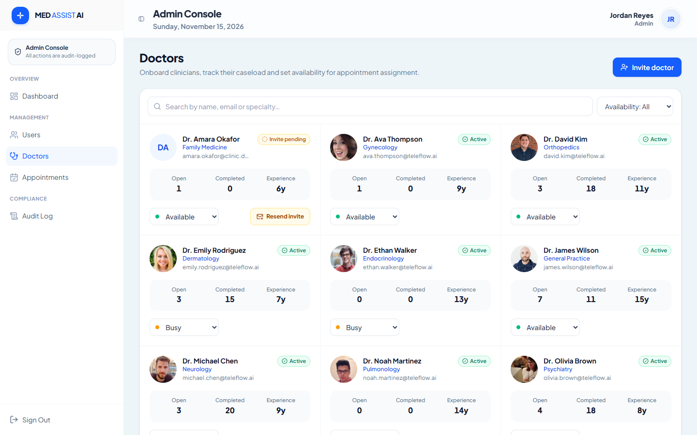 |

| Audit log | Mobile |
|---|---|
| 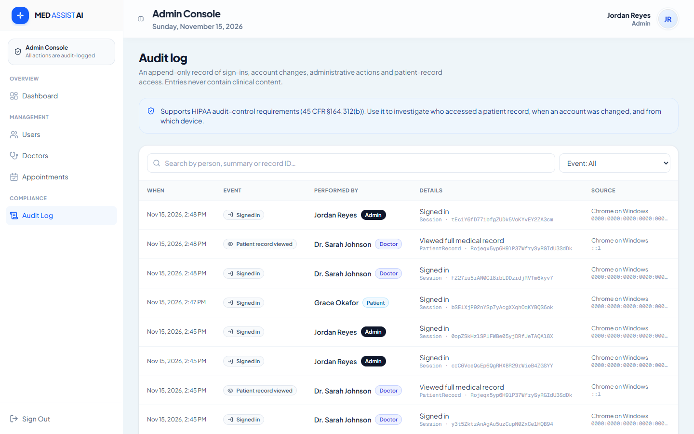 | 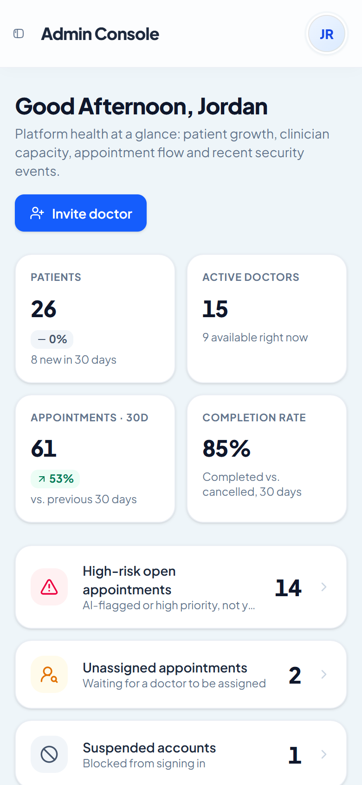 |

### Sign in

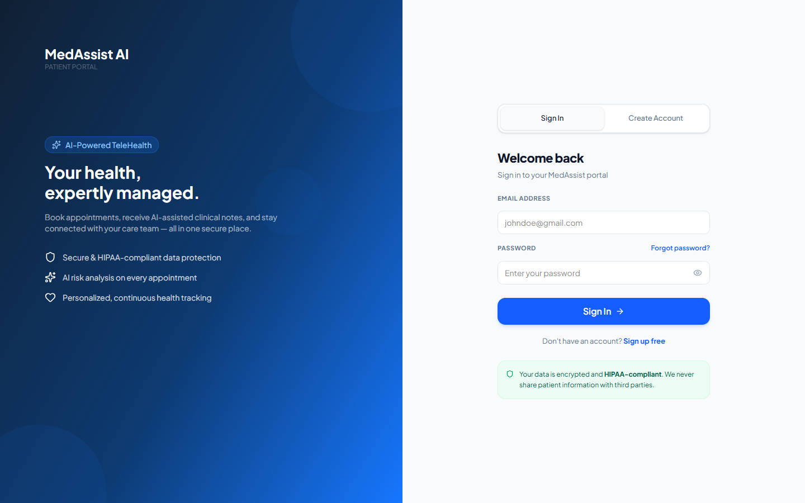

> Screenshots use seeded demo data. No real patient information is shown.

---

## Tech stack

| Layer | Technology |
|---|---|
| Framework | [Next.js 16](https://nextjs.org) (App Router, Server Components, Server Actions, Turbopack) |
| Language | TypeScript 5 |
| UI | React 19, [Tailwind CSS 4](https://tailwindcss.com), [shadcn/ui](https://ui.shadcn.com) on [Base UI](https://base-ui.com), Lucide & Hugeicons |
| Forms & validation | React Hook Form, [Zod 4](https://zod.dev) |
| Charts & calendar | [Recharts 3](https://recharts.org), [FullCalendar 6](https://fullcalendar.io) |
| Auth | [Better Auth 1.6](https://www.better-auth.com) (email/password, email verification, password reset, Google OAuth, rate limiting) |
| Database | PostgreSQL ([Neon](https://neon.tech)) via [Prisma 7](https://www.prisma.io) and the `@prisma/adapter-pg` driver adapter |
| AI | Google Gemini via [`@google/genai`](https://www.npmjs.com/package/@google/genai) (risk analysis, SOAP drafts, patient summaries) |
| Real-time | [Socket.IO 4](https://socket.io) (standalone server in `server.ts`) |
| Email | [Resend](https://resend.com) REST API or any SMTP server via [Nodemailer](https://nodemailer.com) (console output in development) |
| Notifications UI | Sonner toasts |
| Dates | date-fns 4 |

---

## Architecture

```
┌──────────────────────────────┐         ┌───────────────────────────┐
│ Next.js app (:3000)          │         │ Socket.IO server (:3001)  │
│  • App Router pages (RSC)    │◀──ws───▶│  server.ts                │
│  • Server Actions (actions/) │         │  presence, rooms, message │
│  • proxy.ts (route guard)    │         │  persistence              │
│  • /api/auth/* (Better Auth) │         └─────────────┬─────────────┘
└──────────────┬───────────────┘                       │
               │ Prisma (adapter-pg)                   │ Prisma
               ▼                                       ▼
        ┌──────────────────────────────────────────────────┐
        │ PostgreSQL (Neon)                                │
        └──────────────────────────────────────────────────┘
               │
               ├─▶ Google Gemini (triage, SOAP drafts, summaries)
               └─▶ Resend or SMTP (verification, reset, staff invites)
```

- **Route protection.** `proxy.ts` checks the session and role on every request. Users who are signed in but on the wrong area are sent to their own dashboard, and users who are signed out are sent to `/auth/login?next=…`.
- **Defence in depth.** Server actions are public endpoints, so every admin mutation calls `requireAdmin()` again (`lib/authz.ts`). Admin read queries live in `lib/data/` as plain server functions, not `'use server'` actions, so they can't be called from the client.
- **Auth hooks.** Better Auth database hooks enforce account suspension at session creation, which covers password, OAuth and verification sign-ins. The same hooks write audit events.

---

## Getting started

### Prerequisites
- Node.js 20+ (developed on Node 24)
- A PostgreSQL database. A free [Neon](https://neon.tech) project works, as does local Postgres or `npx prisma dev`.
- Optional: a Google Gemini API key for the AI features.

### 1. Install

```bash
git clone <your-fork-url> med-assist-ai
cd med-assist-ai
npm install
```

### 2. Configure the environment

```bash
cp .env.example .env
```

Fill in at least `DATABASE_URL` and `BETTER_AUTH_SECRET` (generate one with `openssl rand -base64 32`). See [Environment variables](#environment-variables) for the rest.

### 3. Create the schema and seed data

```bash
npx prisma migrate deploy
npx prisma db seed
```

The seed creates 10 demo doctors, using `SEED_DOCTOR_PASSWORD` (default `password1234`). If `SEED_ADMIN_EMAIL` and `SEED_ADMIN_PASSWORD` are set, it also creates your first **administrator**. Admin accounts can't be created through public sign-up.

### 4. Run

```bash
npm run dev      # Next.js app  → http://localhost:3000
npm run socket   # Socket.IO server for real-time chat → :3001 (SOCKET_PORT)
```

In development, verification, password-reset and invite emails are **printed to the terminal** running `npm run dev` unless an email provider (Resend or SMTP) is configured. Open the link from there to complete the flow.

### Scripts

| Command | What it does |
|---|---|
| `npm run dev` | Generates the Prisma client and starts Next.js in development mode |
| `npm run socket` | Starts the standalone Socket.IO server (`server.ts`) |
| `npm run build` | Generates the Prisma client and builds for production |
| `npm run start` | Serves the production build |
| `npm run lint` | Runs ESLint |
| `npx prisma db seed` | Seeds demo doctors and, optionally, the first admin |

---

## Environment variables

All variables are documented in [`.env.example`](.env.example).

| Variable | Required | Purpose |
|---|---|---|
| `DATABASE_URL` | ✅ | PostgreSQL connection string |
| `BETTER_AUTH_SECRET` | ✅ | Secret for signing sessions and tokens |
| `BETTER_AUTH_URL` | ✅ | Public URL of the app (auth callbacks, email links) |
| `NEXT_PUBLIC_APP_URL` | ✅ | Same as above, exposed to the browser |
| `GEMINI_API_KEY` | For AI features | Google Gemini key for triage, SOAP drafts and summaries |
| `EMAIL_FROM` | ✅ in production | Sender address. With Gmail SMTP it must match `SMTP_USER` (defaults to it when empty) |
| `RESEND_API_KEY` | One email provider in production | Resend delivery. Needs a domain verified in Resend |
| `SMTP_HOST`, `SMTP_PORT`, `SMTP_USER`, `SMTP_PASS` | One email provider in production | SMTP delivery via Nodemailer, e.g. Gmail with an app password. Used when Resend isn't configured |
| `GOOGLE_CLIENT_ID`, `GOOGLE_CLIENT_SECRET` | Optional | Enables "Continue with Google". Redirect URI: `{BETTER_AUTH_URL}/api/auth/callback/google` |
| `NEXT_PUBLIC_SOCKET_URL`, `SOCKET_PORT` | For chat | Where the Socket.IO server listens (hosts like Render set `PORT`, which takes precedence) |
| `SOCKET_AUTH_SECRET` | For chat | Signs chat connection tokens. Must be the **same value** on the Next.js app and the socket server |
| `SEED_DOCTOR_PASSWORD` | Seeding | Password for demo doctor accounts |
| `SEED_ADMIN_EMAIL`, `SEED_ADMIN_PASSWORD`, `SEED_ADMIN_NAME` | Seeding | Creates the first administrator |
| `EMAIL_TRANSPORT` | Local demos only | Set to `console` to print emails even in a production build. Never set this on a real deployment |

---

## Database & migrations

- The schema lives in [`prisma/schema.prisma`](prisma/schema.prisma), and the Prisma client is generated into `generated/prisma`.
- **Always change the schema through migrations** (`npx prisma migrate dev --name <change>` locally, `npx prisma migrate deploy` in CI or production). Avoid `prisma db push` against shared databases: it bypasses migration history and can drop columns or tables that aren't in the schema.
- **Databases that predate the admin console.** If yours received an earlier admin schema through `db push` (legacy `audit_log`, `AdminProfile`, `doctor_invitation`), don't push. Run the non-destructive reconcile script instead. It archives the old audit log as `audit_log_legacy`, keeps every row and leaves the other tables untouched:

  ```bash
  npx prisma db execute --file prisma/manual/reconcile-legacy-admin-schema.sql
  npx prisma migrate resolve --applied 20260621003937_messaging_architecture_overhaul
  npx prisma migrate resolve --applied 20261115140000_admin_console_and_audit_log
  npx prisma migrate deploy
  ```

---

## Security & privacy

MedAssist AI is built with HIPAA-conscious patterns. Real deployments still need the organisational, contractual (BAA) and infrastructure controls that HIPAA requires; code alone doesn't make an application compliant.

- **Role-based access control** at three layers: the proxy for routes, `requireAdmin()` for admin actions, and assignment checks for clinician access to patient records.
- **Audit controls** (45 CFR §164.312(b)): sign-ups, sign-ins, password resets, every admin mutation and every doctor view of a full patient record are written to `audit_log` with the actor, IP address and device. Entries never contain clinical content.
- **Minimum necessary.** Admin screens show account and operational data only. Intake forms, symptoms, SOAP notes and prescriptions are never selected in admin queries.
- **Account security**: required email verification, single-use one-hour reset links, sign-out everywhere on password reset or suspension, rate-limited auth endpoints, and server-assigned roles (clients can't set a role).
- **Credential hygiene.** Staff accounts are created without a password, and the invitee chooses one through an emailed link.

---

## Project structure

```
app/
  (auth)/auth/          login, signup redirect, forgot/reset password, post-auth callback
  (patient)/patient/    patient dashboard, booking, appointments, messages, notifications, profile
  (doctor)/doctor/      clinical dashboard, appointments, patient records, messages, notifications
  (admin)/admin/        dashboard, users (+ detail), doctors, appointments, audit log
  api/auth/[...all]/    Better Auth handler
actions/                Server Actions (patient, doctor, admin, messaging, notifications)
components/
  admin/                admin console components (tables, filters, dialogs, charts)
  auth/                 auth layout and form primitives
  doctor/ patient/ messages/
  ui/                   shadcn/ui primitives
lib/
  auth.ts               Better Auth configuration (+ hooks for suspension and audit)
  authz.ts              requireAdmin guards
  audit.ts              audit log writer
  data/admin.ts         admin read queries (not client-callable)
  email.ts              email transport and templates
prisma/
  schema.prisma, migrations/, seed.ts, manual/
proxy.ts                route protection and role-based redirects
routes.ts               route groups and post-login redirect helpers
server.ts               Socket.IO server
validations/ schema/    Zod schemas
```

---

## Deployment

The app targets **Vercel + Neon**:

1. Create a Neon database and set `DATABASE_URL` in the Vercel project.
2. Set the remaining variables from `.env.example`. Variables marked **Sensitive** in Vercel can't be read back later, so keep a copy in your secret manager.
3. Run migrations as part of your release (`npx prisma migrate deploy`).
4. Configure email: either Resend (`RESEND_API_KEY`, `EMAIL_FROM` on a verified domain) or SMTP (`SMTP_HOST`, `SMTP_PORT`, `SMTP_USER`, `SMTP_PASS`; Gmail with an app password works). In production, the app refuses to silently skip auth emails.
5. Deploy the Socket.IO server (`server.ts`) to a host that supports long-lived WebSocket connections (build: `npm install && npx prisma generate`, start: `npm run socket`). Give it `DATABASE_URL`, `NEXT_PUBLIC_APP_URL` (your app's URL, used for CORS) and `SOCKET_AUTH_SECRET`, then point `NEXT_PUBLIC_SOCKET_URL` on the app at it. The same `SOCKET_AUTH_SECRET` must be set on the app: the browser fetches a short-lived signed token from `/api/socket-token` and the socket server rejects connections without a valid one.

---

## Known limitations & roadmap

- **No automated tests yet.** Next up: unit tests for the server actions and Playwright end-to-end tests for auth, booking, messaging and admin flows, run in CI.
- **TypeScript strictness.** `next.config.ts` sets `typescript.ignoreBuildErrors`. A few type errors remain in older doctor and patient components.
- **Server action hardening.** Some doctor actions take a `doctorId` argument from the client. They should derive the user from the session instead.
- **Rate limiting** uses Better Auth's in-memory store, which only works on a single instance. Use Redis or database storage when scaling horizontally.
- **Audit log hardening**: write-once storage or a revoked `UPDATE`/`DELETE` grant, a retention policy, and alerting on unusual record access.
- **Planned**: profile and password settings for signed-in users, MFA for clinicians and admins, and bulk actions in the admin console.
